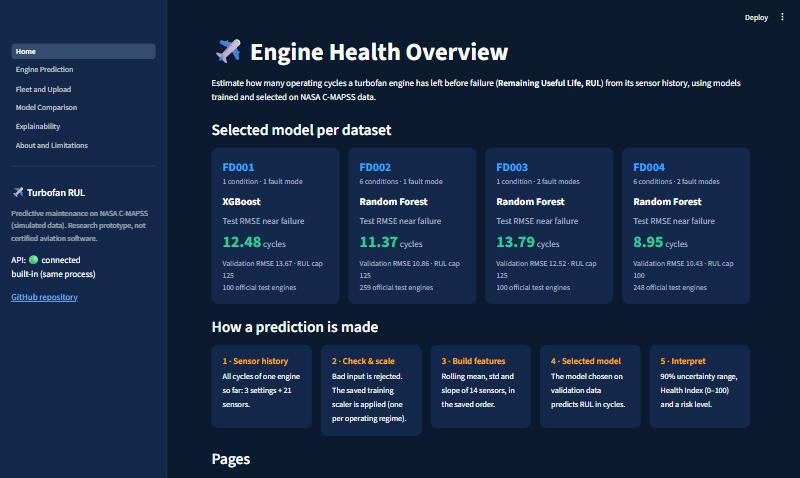
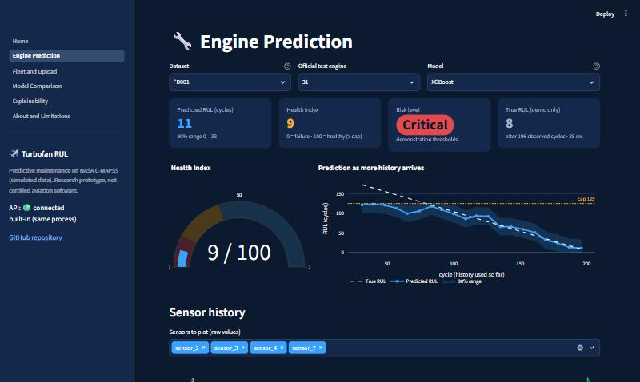
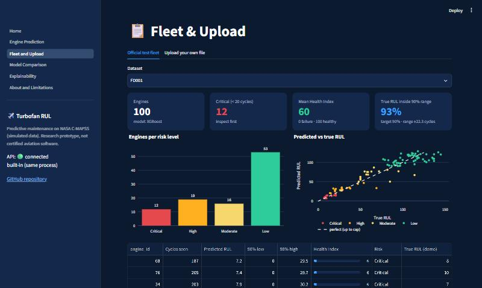
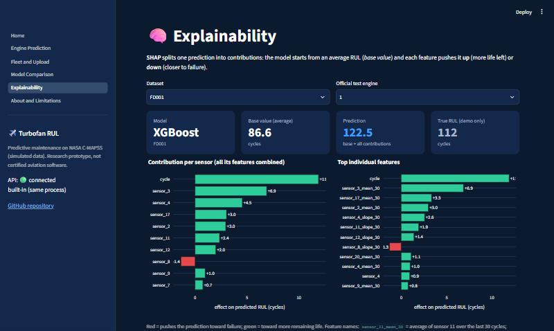
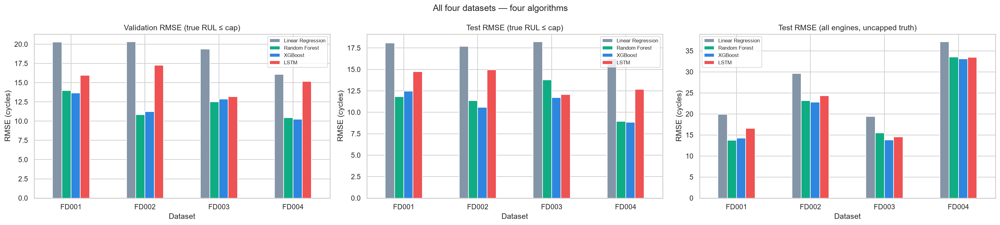
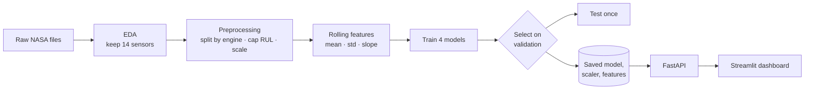

<div align="center">

# ✈️ Turbofan Engine Remaining Useful Life Prediction

**Intelligent predictive maintenance with machine learning on NASA C-MAPSS**

[](https://turbofan-rul-prediction-system.streamlit.app)


### 🔗 Live demo: **[turbofan-rul-prediction-system.streamlit.app](https://turbofan-rul-prediction-system.streamlit.app)**

**Try it with your own data → [Predict Your Engine](https://turbofan-rul-prediction-system.streamlit.app/Predict_Your_Engine)**

</div>

---

How many flights does an engine have left before it fails? This project answers that from raw sensor data.
It predicts the **Remaining Useful Life (RUL)** of turbofan engines on all four NASA C-MAPSS datasets,
reaching **about 9 to 14 cycles of error near failure**, and serves the predictions through a FastAPI backend
and an interactive Streamlit dashboard with uncertainty ranges, a Health Index, risk levels and SHAP explanations.

> ⚠️ Research and teaching prototype on **simulated** NASA data. Not certified aviation software and not for real maintenance decisions.

<p align="center">
  
  
</p>
<p align="center">
  
  
</p>

## ✨ Highlights

| | |
|---|---|
| 🎯 **Accurate near failure** | Test RMSE 8.95 to 13.79 cycles for engines with true RUL at or below the cap |
| 🔒 **Leakage-safe** | Split by engine, scalers fitted on training engines only, test labels opened only after the model was frozen |
| 🧪 **Honest evaluation** | Validation predicted test error within about 1.5 cycles on every dataset |
| 🌲 **16 models compared** | Linear Regression, Random Forest, XGBoost and LSTM on FD001 to FD004 |
| 📏 **Uncertainty** | 90% prediction range from split-conformal calibration |
| 🧠 **Explainable** | SHAP shows which sensors pushed each prediction up or down |
| 🖥️ **Usable** | FastAPI backend + 7-page Streamlit dashboard: upload your own engine data, fleet ranking |

## 📊 Results on the official NASA test sets

The model for each dataset was chosen **on validation data only**, frozen in `models/<FD>/selected_model.json`, then tested once.

| Dataset | Conditions · fault modes | Selected model | RUL cap | Validation RMSE | **Test RMSE (true RUL ≤ cap)** | Test RMSE (all engines) |
|---|---|---|---:|---:|---:|---:|
| FD001 | 1 · 1 | XGBoost | 125 | 13.67 | **12.48** | 14.22 |
| FD002 | 6 · 1 | Random Forest | 125 | 10.86 | **11.37** | 23.19 |
| FD003 | 1 · 2 | Random Forest | 125 | 12.52 | **13.79** | 15.46 |
| FD004 | 6 · 2 | Random Forest | 100 | 10.43 | **8.95** | 33.51 |

<p align="center"></p>

- Tree ensembles (Random Forest, XGBoost) beat Linear Regression and the LSTM on every dataset.
- Overall RMSE is higher on FD002/FD004 because many test engines have far more life left than the cap; the model correctly reports them as "healthy" without an exact number.
- All 16 models: [`reports/final_comparison/all_models_all_datasets.csv`](reports/final_comparison/all_models_all_datasets.csv)

## ⚙️ How it works



| Step | What happens | Why |
|---|---|---|
| **Split by engine** | Whole engines go to train or validation, never single rows | Rows of one engine are nearly identical; a row split leaks |
| **Capped RUL target** | RUL above 125 cycles (100 on FD004) counts as 125 | Sensors barely change early in life; cut error near failure from 32.0 to 19.7 |
| **Per-regime scaling** | FD002/FD004: one scaler per operating condition (6 regimes) | Removes regime jumps that hide wear; 23.21 → 18.15 RMSE on FD004 |
| **Causal rolling features** | Mean, std and slope of each sensor over the last 30 (or 200) cycles | Trends beat single noisy readings; 19.7 → 15.1 RMSE on FD001 |
| **Test-like validation** | Each validation engine is cut at 10 random points, like the test set | The score matches the real task |

## 🖥️ Dashboard pages

| Page | What you can do |
|---|---|
| **Overview** | Selected model and test score for each dataset |
| 🔮 **Predict Your Engine** | Upload or paste **your own engine's sensor history** (NASA .txt or CSV) and get remaining life, 90% range, Health Index, risk, trend and SHAP explanation for every engine; template, sample and NASA examples included |
| **Engine Prediction** | RUL, 90% range, Health Index, risk level and the prediction as history grows |
| **Fleet & Upload** | Rank every official test engine by risk |
| **Model Comparison** | Validation and test results for all 16 models |
| **Explainability** | SHAP contributions per sensor and per feature |
| **About & Limitations** | Definitions, uncertainty coverage and the limits of the system |

## 🚀 Run it locally

```bash
git clone https://github.com/ishaan-89/turbofan-rul-prediction.git
cd turbofan-rul-prediction
python -m venv .venv
.venv\Scripts\activate             # macOS/Linux: source .venv/bin/activate
pip install -r requirements.txt
streamlit run dashboard/Home.py    # http://localhost:8501
```

The dashboard runs the FastAPI backend inside the same process, so one command is enough.
To run the API as its own service instead:

```bash
pip install -r requirements_app.txt
uvicorn api.main:app --port 8000          # interactive docs at http://127.0.0.1:8000/docs
set RUL_API_URL=http://127.0.0.1:8000     # macOS/Linux: export RUL_API_URL=...
streamlit run dashboard/Home.py
pytest -q                                 # 30 tests
```

API endpoints include `/predict`, `/predict/file`, `/explain`, `/datasets/{fd}/fleet` and `/reports/comparison`. See [README_APP.md](README_APP.md).

## 📁 Repository layout

```
notebooks/   02–14: EDA, preprocessing, features, training and evaluation per dataset + final comparison
src/         shared pipeline: data loading, preprocessing, features, training, prediction
models/      trained models + saved preprocessing for FD001–FD004
reports/     figures, experiment tables, validation and test results
api/         FastAPI backend (prediction, uncertainty, Health Index, risk, SHAP)
dashboard/   Streamlit dashboard (7 pages)
data/        NASA C-MAPSS test and RUL files used by the dashboard
tests/       pytest suite for the API
```

## ⚠️ Limitations

- Simulated data only; valid for engines and operating regimes like those in training (unknown regimes are rejected).
- Predictions above the cap mean "healthy", not an exact number.
- Small validation sets (20 to 52 engines): differences under about 0.5 cycles are noise.
- The 90% range covered 84% to 93% of test engines (below target on FD002 and FD003).
- Health Index and risk levels are illustrative definitions, not industry standards.

## 📚 Data

NASA C-MAPSS turbofan degradation data: A. Saxena, K. Goebel, D. Simon, N. Eklund, *"Damage Propagation Modeling for Aircraft Engine Run-to-Failure Simulation"*, PHM 2008. NASA Ames Prognostics Data Repository.

## 👤 Contributor

<table>
  <tr>
    <td align="center">
      <a href="https://github.com/ishaan-89">
        <br>
        <b>Ishaan Jain</b>
      </a><br>
      B.Tech Computer Science<br>Thapar Institute of Engineering and Technology
    </td>
  </tr>
</table>
